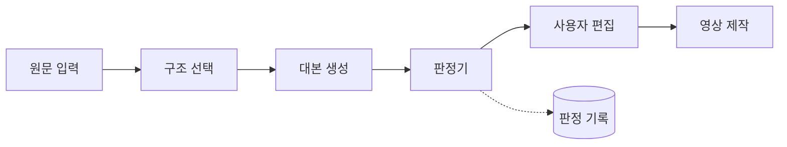

# 쇼츠 대본 품질 판정기

## 개요

쇼츠를 생성할 때 사용하는 대본의 품질을 판별하는 판정기.  
대본이 생성된 직후 해당 대본을 받아, 항목별 측정값과 판정을 기록으로 남긴다. 규칙으로 잴 수 있는 것은 스크립트로 검증.  
문장의 뜻을 봐야 하는 판단만 로컬 오픈 모델(`gemma4:e4b`)를 활용하고, 판정기는 대본을 수정하지 않습니다.  
  


처음에는 쇼츠생성 서비스내에 대본을 판정하면서 생성된 대본 수정으로 퀄리티를 높이는 방향으로 잡으려고 했다.  
진행 도중 해당 판정기는 검증만 진행하도록 변경했다,  
이유는 쇼츠 생성 플로우를 생각해볼 때  
사용자가 제공한 자료를 리서치하고 대본으로 생성하는 과정에서  
대본을 생성 시키는 하네스의 대본 구현 단계의 퀄리티가 낮다면 판정기만으로 대본의 근본적인 퀄리티를 높일 수 없고,  
LLM 사용한다면 생성된 대본을 판정기가 수정하는데 더 많은 리소스가 소비된다고 생각했다.  
때문에  이 판정기는 대본 검증을 진행하면서 쌓이는 데이터를 통해 대본 생성기의 퀄리티를 높이는것이 근본적인 문제 해결이라고 생각했다.  
하여 완성된 대본은 수정하지않고 퀄리티 체크만 진행하고 사용자에게 그대로 전달하기로 했다.  
만약 판정기에서 대본에 대한 퀄리티 판정문을 사용자에게 제공하는 경우 사용자는 서비스가 생성하는 결과물에 대해 불신이 생길 수 있기 때문이다.  


| 구분  | 내용                                                               |
| --- | ---------------------------------------------------------------- |
| 입력  | 사용자가 고른 구조와 문장 목록(문장, 역할 라벨)                                     |
| 출력  | 항목 18개의 측정값과 판정을 담은 JSON 기록                                      |
| 도구  | TypeScript(Node.js), 한국어 형태소 분석기 Kiwi, 로컬 Ollama 모델 `gemma4:e4b` |


## 목차

1. [실행 방법](#1-실행-방법)
2. [좋은 대본의 기준](#2-좋은-대본의-기준)
3. [판정 방식](#3-판정-방식)
4. [검증](#4-검증)
5. [사용한 시간](#5-사용한-시간)

---

## 1. 실행 방법

### 1.1 준비


| 필요한 것                  | 확인한 버전          | 용도                                                |
| ---------------------- | --------------- | ------------------------------------------------- |
| Node.js                | 22.23.1         | 판정기 실행. TypeScript 파일을 빌드 없이 실행하므로 22.18 이상이 필요하다 |
| Ollama                 | 0.31.1          | 로컬 모델 실행                                          |
| Ollama 모델 `gemma4:e4b` | 디스크 6.6GB       | 대본 단위 판단                                          |
| Kiwi 모델 파일             | 0.25.0, 약 100MB | 한국어 형태소 분석. `npm run setup`이 내려받는다                |


```sh
npm ci
npm run setup            # Kiwi 모델을 내려받고 SHA-256을 확인한 뒤 models/kiwi에 푼다
ollama pull gemma4:e4b
```

확인한 기기는 Apple M5 Pro, 메모리 48GB다.

### 1.2 판정하기

대본 하나로 단위 테스트부터 모델 판단까지 차례로 돌린다. 결과는 JSON 파일 하나로 나온다.

```sh
npm run pipeline -- examples/scripts/10-event-winter.json
npm run pipeline -- <대본.json> --out result.json
```


| 단계     | 하는 일                                     |
| ------ | ---------------------------------------- |
| 단위 테스트 | 측정 함수가 정의대로 동작하는지 확인한다(테스트 38개)          |
| 입력 검사  | 대본 파일의 형식을 확인한다                          |
| 도구 준비  | 형태소 분석기(Kiwi)와 Ollama 모델을 불러온다           |
| 판정     | 스크립트 항목을 재고, 모델에 대본 전체를 한 번 보내 모델 항목을 잰다 |


한 단계가 실패하면 뒤 단계는 건너뛰고, 거기까지의 결과를 파일에 쓴다. 네 단계가 모두 통과하면 종료 코드 0, 아니면 1이다. `--out`을 주지 않으면 `results/<scriptId>.json`에 쓴다. 아래는 10번 예시 대본으로 돌린 결과 파일에서 판정 기록을 줄인 것이다.

```json
{
  "scriptFile": "examples/scripts/10-event-winter.json",
  "ranAt": "2026-11-22T14:35:44.476Z",
  "succeeded": true,
  "steps": [
    {
      "id": "unitTests",
      "name": "단위 테스트",
      "status": "passed",
      "durationMs": 1177,
      "detail": { "tests": 38, "pass": 38, "fail": 0, "skipped": 0, "failedTests": [] }
    },
    {
      "id": "input",
      "name": "입력 검사",
      "status": "passed",
      "durationMs": 1,
      "detail": {
        "scriptId": "sample-10-event-winter",
        "language": "ko",
        "structure": "basic",
        "sentenceCount": 8
      }
    },
    {
      "id": "tools",
      "name": "도구 준비",
      "status": "passed",
      "durationMs": 1080,
      "detail": { "analyzer": "kiwi-nlp 0.25.0", "model": "ollama gemma4:e4b@dc35e8d9c606" }
    },
    {
      "id": "judge",
      "name": "판정",
      "status": "passed",
      "durationMs": 3686,
      "detail": {
        "modelUsage": {
          "calls": 1,
          "promptTokens": 664,
          "outputTokens": 109,
          "durationMs": 3664,
          "succeeded": true
        },
        "measuredItems": 18,
        "skippedItems": [],
        "flaggedItems": ["structure.stepOrder"]
      }
    }
  ],
  "record": {
    "scriptId": "sample-10-event-winter",
    "judgeVersion": "0.5.0",
    "measurements": ["… 항목 18개 (1.5절)"]
  }
}
```

판정 기록만 필요하면 `judge` 명령을 쓴다. 단위 테스트는 돌리지 않는다.

```sh
npm run judge -- <대본.json>                    # 기록을 화면에 출력한다
npm run judge -- <대본.json> --out record.json  # 기록을 JSON 파일 하나로 쓴다
```


| 옵션              | 동작                                                                         |
| --------------- | -------------------------------------------------------------------------- |
| `--out <파일>`    | 결과를 JSON 파일 하나로 쓴다. 같은 파일이 있으면 덮어쓴다. `pipeline`과 `judge` 모두 받는다            |
| `--model <이름>`  | Ollama 모델을 바꾼다. 생각 단계는 `=`로 정한다. 예: `--model gpt-oss:20b=low`. 두 명령 모두 받는다 |
| `--no-model`    | 모델 없이 잰다. 모델 판단이 필요한 5개 항목은 건너뛴다. `judge`만 받는다                             |
| `--no-analyzer` | 형태소 분석기 없이 잰다. 분석기가 필요한 3개 항목은 건너뛴다. `judge`만 받는다                          |


환경 변수 `JUDGE_MODEL`, `KIWI_MODEL_DIR`, `OLLAMA_HOST_URL`로 모델, Kiwi 모델 폴더, Ollama 주소를 바꿀 수 있다.

### 1.3 검증 명령

```sh
npm test                                              # 단위 테스트 38개
npm run check-samples                                 # 예시 대본 12개를 판정하고 기대값과 대조한다
npm run compare-models -- gemma4:e4b gpt-oss:20b=low  # 모델별 대본 단위 판단을 비교한다
npm run typecheck
npm run format:check
```

`check-samples`와 `compare-models`는 Ollama와 해당 모델이 있어야 돈다. `npm test`는 모델 없이 돈다. Kiwi 모델이 없으면 Kiwi 테스트 1개만 건너뛴다.

### 1.4 입력

```json
{
  "scriptId": "sample-10-event-winter",
  "language": "ko",
  "structure": "basic",
  "sentences": [
    { "text": "서울 도심 여섯 곳이 한꺼번에 겨울 축제장이 됩니다.", "type": "hook" },
    { "text": "2025 서울윈터페스타가 12월 12일부터 1월 4일까지 열립니다.", "type": "context" }
  ]
}
```


| 필드                 | 뜻                                                                                                            |
| ------------------ | ------------------------------------------------------------------------------------------------------------ |
| `scriptId`         | 기록을 다른 자료와 잇는 대본 식별자                                                                                         |
| `language`         | 대본의 언어. 없으면 `ko`다. `en`, `ja`, `zh`는 형태소 분석기를 끼울 자리만 있다                                                      |
| `structure`        | 사용자가 고른 구조. `basic`, `problem-solution`, `pas`, `aida`, `problem-solution-result`, `story`, `list`           |
| `sentences[].text` | TTS가 읽을 문장                                                                                                   |
| `sentences[].type` | 문장 타입. `hook`, `context`, `problem`, `agitation`, `point`, `solution`, `example`, `result`, `closing`, `cta` |


판정기는 문장마다 문장과 타입 두 가지만 받는다.  
스키마에 없는 필드는 오류 없이 버린다. 구조 7개와 타입 10개는 조사로 만든 목록이다.

### 1.5 출력(기록)

판정기는 대본 하나에 기록 하나를 만든다. 아래는 `10-event-winter.json`의 실제 기록에서 항목 3개만 남기고, 어휘 난이도 항목의 문장별 값을 줄인 것이다.

```json
{
  "scriptId": "sample-10-event-winter",
  "judgeVersion": "0.5.0",
  "judgedAt": "2026-11-22T14:00:40.317Z",
  "language": "ko",
  "analyzer": "kiwi-nlp 0.25.0",
  "model": "ollama gemma4:e4b@dc35e8d9c606",
  "modelUsage": {
    "calls": 1,
    "promptTokens": 664,
    "outputTokens": 109,
    "durationMs": 1516,
    "succeeded": true
  },
  "structure": "basic",
  "totals": { "sentenceCount": 8, "syllableCount": 218 },
  "measurements": [
    {
      "item": "structure.stepOrder",
      "status": "measured",
      "value": 2,
      "facts": { "outOfOrder": 2, "outsideStructure": 0 },
      "sentences": [
        { "index": 5, "value": 1, "note": "\"본문\" 단계의 문장이 \"끝맺음\" 단계 뒤에 있다." },
        { "index": 6, "value": 1, "note": "\"본문\" 단계의 문장이 \"끝맺음\" 단계 뒤에 있다." }
      ],
      "verdict": "flagged"
    },
    {
      "item": "interest.hookQuestion",
      "status": "measured",
      "value": 1,
      "facts": {},
      "sentences": [],
      "verdict": "unset"
    },
    {
      "item": "clarity.vocabulary",
      "status": "measured",
      "value": null,
      "facts": {
        "longestNounRun": 3,
        "longestNounRunWords": "겨울 축제 장",
        "difficultWordRatio": "어휘 등급 목록을 연결하지 않아서 재지 않았다."
      },
      "verdict": "unset"
    }
  ]
}
```


| 필드                      | 뜻                                                                |
| ----------------------- | ---------------------------------------------------------------- |
| `status`                | `measured`는 쟀다는 뜻이다. `skipped`는 재지 않았다는 뜻이고 이유는 `skipReason`에 있다 |
| `value`                 | 항목의 대표 측정값. 값의 뜻은 `src/items.ts`의 항목 정의에 있다                      |
| `facts`                 | 대표값을 설명하는 보조 측정값                                                 |
| `sentences`             | 문장별 측정값과 설명. 문장 번호는 0부터 센다                                       |
| `verdict`               | 기준값이 있으면 `ok` 또는 `flagged`다. 기준값이 없으면 `unset`이다                  |
| `judgeVersion`, `model` | 같은 판정기와 같은 모델 파일로 잰 기록끼리 비교하려고 남긴다                               |
| `modelUsage`            | 모델을 부른 횟수, 입력 토큰, 출력 토큰, 시간(ms)                                  |


---

## 2. 좋은 대본의 기준

### 2.1 판정기가 서는 자리



쇼츠 생성 서비스에서 사용자는 원문을 넣고 구조를 고른다. 시스템은 그 구조에 맞춰 장면 단위 대본을 만든다. 사용자는 대본을 받아 장면을 고치고, 더하고, 지우고, 합치고, 배속을 바꾼 뒤 영상 제작으로 넘어간다. 판정기는 대본 생성과 사용자 편집 사이에 선다. 판정기의 전제는 다음과 같다.

- 대본은 생성 단계의 가드레일을 거쳐서 온다. 판정기는 그 결과가 영상으로 만들기에 맞는지 검사한다.
- 판정기는 대본이 생성된 직후에 한 번만 돈다. 사용자가 편집한 대본은 다시 재지 않는다.
- 판정 결과는 사용자에게 보여 주지 않는다. 사용자는 생성된 대본만 받고, 시스템이 판정 기록을 쌓는다.
- 판정기는 대본을 고치지 않는다.

### 2.2 정의

판정기는 영상이 좋은지를 판단하지 않는다.  
아래 대본을 좋은 대본으로 본다.

> 영상으로 만들 때 방해가 되는 요소가 없고, 시청자가 한 번 듣고 따라오며 계속 볼 이유를 갖춘 대본

이 정의를 네 대상으로 나눈다. 형식은 다른 세 대상을 확인하기 위한 전제다.


| 대상     | 판정기가 묻는 질문                  | 필요한 이유                                                        |
| ------ | --------------------------- | ------------------------------------------------------------- |
| 형식     | TTS와 렌더링에 그대로 넣을 수 있는가      | 판정기 다음 단계가 TTS와 렌더링이다. 값이 비었거나 TTS가 잘못 읽는 표기가 있으면 영상이 깨진다     |
| 구조     | 사용자가 고른 구조대로 짜였고, 문장이 이어지는가 | 서비스는 사용자가 고른 구조로 대본을 만든다. 구조를 어기면 사용자가 고른 영상이 아니다             |
| 이해 용이성 | 한 번 듣고 이해되는가                | 쇼츠는 소리로 듣고 지나간다. 시청자는 문장을 다시 읽지 않는다                           |
| 흥미 유발  | 계속 볼 이유가 있는가                | 쇼츠는 첫 몇 초에 이탈이 몰린다는 관찰이 많다. 다만 공개된 수치는 측정 방법이 밝혀지지 않아 근거가 약하다 |


각 대상에서 대본에 있어야 할 것과 없어야 할 것을 정했다. 금지 규칙만 두면 결함은 없지만 재미없는 대본도 통과한다. 그래서 있어야 할 것을 함께 본다.


| 대상     | 있어야 할 것                                                     | 없어야 할 것                                 |
| ------ | ----------------------------------------------------------- | --------------------------------------- |
| 형식     | 문장과 타입이 유효한 값                                               | URL, 괄호, 기호, 이모지, 영문 약어처럼 TTS가 잘못 읽는 표기 |
| 구조     | 필수 단계, 단계 순서, 첫 단계로 시작하고 끝 단계로 끝남, 라벨과 맞는 역할, 앞 문장과 이어지는 화제 | 한 단계가 분량을 독차지함                          |
| 이해 용이성 | 한 문장에 내용 하나, 대상이 분명한 지시어                                    | 긴 문장, 명사 나열과 어려운 어휘                     |
| 흥미 유발  | 구체적인 내용이 있는 훅, 훅의 질문에 답하는 본문, 문장마다 흥미 장치                    | 예고나 감탄뿐인 문장, 같은 내용의 반복, 흥미 장치가 없는 긴 구간  |


흥미 장치는 네 가지로 정했다. 질문, 의외나 대비, 구체적인 수치나 사례, 시청자에게 생기는 이득이나 손해다.

### 2.3 근거


| 기준         | 근거                                                                                                                                                                                                                                                                                                                                   |
| ---------- | ------------------------------------------------------------------------------------------------------------------------------------------------------------------------------------------------------------------------------------------------------------------------------------------------------------------------------------ |
| 질문과 의외의 사실 | 정보 격차 이론은 답이 없는 질문이 두드러질수록 호기심이 커진다고 본다([Golman, Loewenstein 외](https://www.cmu.edu/dietrich/sds/docs/golman/the-demand-for__and-avoidance-of__information.pdf)). 위챗 기사 10만여 건 분석에서 질문, 중요성, 의외의 주제를 담은 제목의 클릭이 많았다([Curiosity in news consumption](https://deepblue.lib.umich.edu/items/e4235eeb-79e7-4491-85c9-92425c1fd8d9/full)) |
| 구체성        | 제목 실험 27,616건에서 모호한 제목은 구체적으로 바꾸면 클릭이 늘었고, 이미 구체적인 제목은 더 구체적으로 바꾸면 클릭이 줄었다([Scientific Reports](https://www.ncbi.nlm.nih.gov/pmc/articles/PMC11704130/)). 그래서 숫자가 있는지만으로 훅을 판단하지 않고 모델이 내용을 본다                                                                                                                                       |
| 문장 길이, 어휘  | 한국어 이독성 연구는 문장 길이와 어휘 난이도를 공통 요인으로 쓴다([교과 텍스트 이독성 분석](https://www.kci.go.kr/kciportal/ci/sereArticleSearch/ciSereArtiView.kci?sereArticleSearchBean.artiId=ART003054810), [한국어 읽기 텍스트 난이도 공식](https://www.kci.go.kr/kciportal/ci/sereArticleSearch/ciSereArtiView.kci?sereArticleSearchBean.artiId=ART002560113)). 읽는 글을 대상으로 한 연구다  |
| 구조 7개      | 영상 제작 도구 회사들의 공개 글에서 모았다. 수치로 검증된 목록이 아니다                                                                                                                                                                                                                                                                                            |


쇼츠 대본을 직접 다룬 연구는 찾지 못했다. 위 근거는 기준의 방향을 정하는 데만 썼다. 기준값은 실제 대본을 재서 정해야 한다.

### 2.4 보지 않는 것


| 보지 않는 것               | 이유                                                   |
| --------------------- | ---------------------------------------------------- |
| 원문 충실도                | 선택 항목으로 정했고 구현하지 않았다. 지금 입력에는 원문이 없다.                |
| 안전(과장, 비방)            | 선택 항목으로 정했고 구현하지 않았다                                 |
| 화면, 음성, 배경음           | 판정기 다음 단계에서 정한다                                      |
| TTS 재생 시간과 속도, 말의 빠르기 | 판정기는 대본이 생성된 직후 대본의 내용만 본다. 재생 시간과 속도는 TTS 단계에서 정해진다 |


---

## 3. 판정 방식

### 3.1 결과의 형태: 점수가 아니라 측정 기록

결과의 형태로 점수, 통과와 보류, 항목별 진단을 검토했다. 판정기는 항목별 측정값을 기록하고, 기준값이 있는 항목에만 판정을 붙인다.

- 판정 결과는 사용자에게 가지 않고 시스템의 기록이 된다. 재생성이나 후보 선택에도 쓰지 않는다. 기록은 나중에 기준값을 정하고 대본 생성 단계를 개선하는 자료다.
- 기준값의 근거가 아직 없다. 근거 없이 점수를 매기면 가중치가 임의의 값이 된다. 측정값을 남겨 두면 기준값이 정해진 뒤에 다시 계산할 수 있다.
- 기준값은 정의에서 바로 나오는 4개 항목에만 있다. 필드 유효성, 필수 단계, 단계 순서, 시작과 끝이고 모두 0이어야 한다. 나머지 14개 항목은 측정값만 남기고 판정은 `unset`이다.

지금의 판정기는 판정보다 측정에 가깝다. 기준값은 실제 대본의 측정값 분포를 보고 정한다(4.6절).

### 3.2 처리 흐름

1. **입력 검사**: 스키마(zod)로 JSON의 형태를 확인한다. 형태가 틀리면 기록 없이 멈춘다. 값이 유효한지는 첫 번째 항목이 확인
2. **문장 기본값**: 문장마다 TTS가 읽는 음절 수를 센다. 숫자는 "삼천"처럼 한자어로 읽는다고 보고 센다. 타입 라벨을 구조의 단계 번호로 바꾼다. 형태소 분석 결과를 명사, 접속 표현, 지시어, 절을 잇는 어미 같은 공통 분류로 바꾼다.
3. **모델 판단**: 대본 전체를 모델에 한 번 보내 여섯 가지 판단을 JSON으로 받는다(3.4절).
4. **항목 측정**: 18개 항목을 잰다. 필요한 것이 없으면 이유를 남기고 건너뛴다. 이유는 "한국어가 아님", "분석기 없음", "모델 판단 없음" 순서로 따진다.
5. **판정과 기록**: 기준값이 있는 항목에 판정을 붙이고 기록을 출력한다.

### 3.3 항목 18개

방법의 "스크립트"는 LLM 없이 규칙으로 잰다는 뜻이다. "분석기"는 형태소 분석 결과가 필요하다는 뜻이다. "모델"은 3.4절의 모델 판단을 쓴다는 뜻이다.


| 대상     | 항목            | 구분  | 방법       | 재는 값                                                 | 기준값  |
| ------ | ------------- | --- | -------- | ---------------------------------------------------- | ---- |
| 형식     | 필드와 값의 유효성    | 있어야 | 스크립트     | 빈 문장이나 목록에 없는 타입이 있는 문장의 수                           | 0 이하 |
| 형식     | TTS가 잘못 읽는 표기 | 없어야 | 스크립트     | URL·이메일, 괄호, 이모지, 기호, 영문 대문자 약어의 수                   | 없음   |
| 구조     | 필수 단계         | 있어야 | 스크립트     | 고른 구조의 필수 단계 중 타입 라벨로 찾지 못한 단계의 수                    | 0 이하 |
| 구조     | 단계 순서         | 있어야 | 스크립트     | 앞 단계로 되돌아간 문장과 타입이 구조에 없는 문장의 수                      | 0 이하 |
| 구조     | 시작과 끝         | 있어야 | 스크립트     | 첫 단계로 시작하지 않거나 끝 단계로 끝나지 않으면 1씩. 훅의 음절 수도 남긴다        | 0 이하 |
| 구조     | 분량 배분         | 없어야 | 스크립트     | 단계별 음절 수 비율 중 가장 큰 값                                 | 없음   |
| 구조     | 문장 간 연결       | 있어야 | 모델       | 모델이 앞 문장과 화제가 끊긴다고 본 문장의 수                           | 없음   |
| 구조     | 타입 일치         | 있어야 | 모델       | 타입 라벨의 단계와 모델이 고른 단계가 다른 문장의 수                       | 없음   |
| 이해 용이성 | 문장 길이         | 없어야 | 스크립트     | 가장 긴 문장의 음절 수                                        | 없음   |
| 이해 용이성 | 한 문장 한 내용     | 있어야 | 분석기      | 절을 잇는 연결 어미의 수에 1을 더한 절의 수. 문장 중 가장 큰 값              | 없음   |
| 이해 용이성 | 어휘 난이도        | 없어야 | 분석기      | 명사가 연달아 나온 가장 긴 길이. 어려운 단어의 비율은 어휘 등급 목록이 없어 비어 있다   | 없음   |
| 이해 용이성 | 가리키는 대상       | 있어야 | 분석기, 모델  | 지시어가 있는 문장 중 모델이 대상을 앞에서 알 수 없다고 본 문장의 수             | 없음   |
| 흥미 유발  | 문장별 흥미 장치     | 있어야 | 스크립트, 모델 | 흥미 장치가 하나 이상 있는 문장의 비율                               | 없음   |
| 흥미 유발  | 훅의 내용         | 있어야 | 모델       | 첫 문장에 영상이 다룰 구체적인 내용이 있으면 1                          | 없음   |
| 흥미 유발  | 훅의 해소         | 있어야 | 모델       | 뒤의 문장들이 첫 문장의 질문이나 주장에 답하면 1                         | 없음   |
| 흥미 유발  | 내용 없는 문장      | 없어야 | 스크립트     | "알아보겠습니다" 같은 예고나 "정말 놀랍" 같은 감탄이 있는 문장의 수. 훅과 끝맺음은 제외 | 없음   |
| 흥미 유발  | 반복            | 없어야 | 스크립트     | 두 문장의 글자 겹침 비율(0\~1) 중 가장 큰 값                        | 없음   |
| 흥미 유발  | 장치 없는 구간      | 없어야 | 스크립트, 모델 | 흥미 장치가 없는 문장이 이어진 가장 긴 구간의 음절 수                      | 없음   |


판정기는 재생 시간을 받지 않으므로 분량은 TTS가 읽을 음절 수로 잰다. 음절 수는 숫자를 한자어로 읽는다고 가정한 어림값이다. 항목 정의는 `src/items.ts`, 측정 함수는 `src/measure/`에 있다. 문장별 흥미 장치에서 질문, 의외나 대비, 구체적인 수치나 사례는 표현 목록으로 찾고, 시청자에게 미치는 영향은 모델이 판단한다.

### 3.4 모델이 맡는 판단

모델에는 대본 하나를 한 번 보낸다. 문장의 뜻과 앞뒤 흐름을 봐야 하는 판단만 모델에 맡긴다.

**보내는 것**: 구조의 이름과 단계(이름, 필수 여부, 역할 설명), 번호를 붙인 문장 목록. 타입 라벨은 보내지 않는다. 모델이 라벨을 보지 않고 단계를 고르게 한 뒤 라벨과 비교하기 위해서다.

**받는 것**: 아래 여섯 가지를 JSON으로 받는다. Ollama의 `format`에 JSON 스키마를 넣어 형식을 강제한다. 단계는 번호가 아니라 이름 목록에서 고르게 한다. 번호로 고르게 했을 때 `gemma4:e4b`가 대본 10개 중 6개에서 단계 번호 대신 문장 번호를 적었기 때문이다.


| 필드                  | 지시                                                             | 쓰는 항목     |
| ------------------- | -------------------------------------------------------------- | --------- |
| `steps`             | 문장마다 어느 단계에 속하는지 단계 이름을 적는다                                    | 타입 일치     |
| `topicBreaks`       | 앞 문장과 화제가 끊기는 문장 번호. 목록형에서 다음 항목으로 넘어가는 문장과 마무리 문장은 넣지 않는다     | 문장 간 연결   |
| `impactSentences`   | 시청자에게 생기는 이득이나 손해(돈, 시간, 건강, 기회)를 말하는 문장 번호                    | 문장별 흥미 장치 |
| `unclearReferences` | 지시어가 있는데 무엇을 가리키는지 앞 문장에서 알 수 없는 문장 번호                         | 가리키는 대상   |
| `hookHasContent`    | 0번 문장에 영상이 다룰 구체적인 내용이 있는가. 인사, 안부, 무엇을 다룰지 알 수 없는 예고뿐이면 false | 훅의 내용     |
| `hookPaidOff`       | 1번 이후 문장들이 0번 문장의 질문이나 주장에 답이나 근거를 주는가                         | 훅의 해소     |


**답 검사**: 판정기는 답이 JSON 객체인지, 단계 배열의 길이가 문장 수와 같은지, 단계 이름이 구조에 있는지, 문장 번호가 범위 안인지, 참거짓 값이 맞는지 확인한다. 하나라도 틀리면 한 번 더 부른다. 두 번 모두 틀리면 모델 판단이 필요한 5개 항목만 건너뛰고 나머지 13개는 잰다.

**스크립트로 모델을 견제한다**:

- 가리키는 대상 항목은 모델이 짚은 문장 중 Kiwi가 지시어를 찾은 문장만 센다.
- 타입 일치 항목은 같은 단계 안의 타입 차이(배경과 포인트 등)를 세지 않는다.
- 흥미 장치는 스크립트가 찾은 장치에 모델이 찾은 영향을 더한다. 모델 판단이 없으면 스크립트로 찾은 장치만으로 잰다.

**재현**: `temperature 0`, `seed 0`으로 부르고 생각 단계는 끈다. 기록에는 모델 이름과 모델 파일의 식별값, 판정기 버전, 사용량을 남긴다.

프롬프트 전문은 `src/model/review.ts`에 있다.

### 3.5 트레이드오프


| 결정                      | 얻은 것                                                       | 잃은 것                                                              |
| ----------------------- | ---------------------------------------------------------- | ----------------------------------------------------------------- |
| 규칙으로 잴 수 있는 것은 스크립트로 잰다 | 같은 입력에 같은 결과, 비용 없음, 짚은 이유를 설명할 수 있음                       | 표면만 본다. 예: "하지만"이나 숫자 같은 표지가 없는 흥미로운 사실은 흥미 장치로 잡지 못한다            |
| 모델은 대본 하나에 한 번 부른다      | 모델 호출이 대본당 한 번이다. 답의 형식이 틀리면 한 번만 더 부른다. 모델이 대본 전체의 흐름을 본다 | 답 하나가 틀리면 모델 항목 5개가 함께 빠진다. 여러 판단을 한 번에 하므로 판단별 정확도를 따로 떼어 보기 어렵다 |
| 기본 모델은 `gemma4:e4b`     | 대본당 약 1.2초, 형식 오류 0, 같은 대본에 같은 답, 디스크 6.6GB                | `gpt-oss:20b`가 잡은 훅의 해소 실패(12번 대조 대본)를 놓친다(4.4절)                  |
| 점수 대신 측정 기록을 남긴다        | 기준값이 바뀌어도 다시 계산할 수 있다. 근거 없는 가중치를 만들지 않는다                  | 지금은 14개 항목이 `unset`이다. 시스템이 기록을 받아도 바로 행동할 수 있는 판정이 적다            |
| 대본을 고치지 않는다             | 작은 모델이 고쳐 쓰며 숫자와 말투를 바꾸는 문제를 피한다. 사용자의 편집 단계를 존중한다         | 문제를 찾아도 고치지 않는다. 고치는 일은 사용자의 편집에 맡긴다                              |
| 형태소 분석기는 Kiwi           | 명사, 연결 어미, 지시어를 구분해 절의 수, 명사 나열, 지시어를 잰다                   | 모델 파일 약 100MB를 따로 받는다. 합성어를 쪼개서 "재정경제부"를 명사 세 개로 센다               |
| 측정 규칙은 한국어 전용이다         | 범위를 한국어에 집중했다. 분석기는 언어별로 바꿔 끼울 수 있게 만들었다                   | 다른 언어 대본은 18개 중 12개 항목을 재지 못한다                                    |


---

## 4. 검증

### 4.1 무엇을 어떻게 확인했나


| 확인할 것                    | 방법                                              | 결과                                     |
| ------------------------ | ----------------------------------------------- | -------------------------------------- |
| 항목을 정의대로 계산하는가           | 단위 테스트 38개. 가짜 분석기와 가짜 모델로 계산, 건너뛰기, 답 검사를 확인한다 | 모두 통과                                  |
| 일부러 넣은 결함을 잡고 멀쩡한 곳은 두는가 | 예시 대본 12개에 기대 23개를 적고 판정 결과와 대조                 | 23개 중 22개 통과                           |
| 어느 모델이 대본 단위 판단을 해내는가    | 모델 4개에 같은 대본 12개를 두 번씩 보냄                       | 형식을 지킨 모델은 2개. `gemma4:e4b`를 골랐다(4.4절) |
| 같은 대본에 같은 결과가 나오는가       | 같은 대본을 두 번 보내 답을 비교                             | `gemma4:e4b`는 12개 모두 같았다               |
| 판정이 사람의 판단과 맞는가          | 하지 않았다                                          | 4.5절                                   |


### 4.2 예시 대본

예시 대본은 `examples/scripts/`에 있다. 대본 파일마다 원문 정보(`_source`), 일부러 넣은 결함(`_notes.intended`), 기대값(`_expected`)이 들어 있다.

- **원문**: 웹에서 찾은 10건이다. 뉴스 2건, 정보 2건, 재미 2건, 제품 소개, 블로그, 커뮤니티 글, 행사 안내 각 1건이다.
- **대본**: Claude가 원문을 읽고 썼다. 구조 7개를 모두 한 번 이상 썼다. 원문에 없는 사실은 넣지 않았다.
- **대조 대본 2개**: 11번은 03번 대본의 훅만 인사로 바꿨다. 12번은 07번 대본의 훅을 본문이 답하지 않는 질문으로 바꿨다. 둘 다 새 판정기를 돌리기 전에 만들었다.


| #   | 종류   | 원문                                                                                                                                                                     | 구조       | 문장  | 음절  | 일부러 넣은 것               |
| --- | ---- | ---------------------------------------------------------------------------------------------------------------------------------------------------------------------- | -------- | --- | --- | ---------------------- |
| 01  | 뉴스   | [정부 경기 판단 상향 (연합뉴스, 2026-11-13)](https://www.koreancenter.or.kr/news/articleView.html?idxno=1438882)                                                                   | 기본 3단    | 8   | 268 | 절이 네 개인 63음절 문장        |
| 02  | 뉴스   | [휴보 국가과학유산 지정 (사이언스타임즈, 2026-11-12)](https://www.sciencetimes.co.kr/nscvrg/view/menu/255?thisPage=1&searchCategory=226&searchSection=&sersYn=&serlYn=&nscvrgSn=262659) | 기본 3단    | 9   | 243 | 없음                     |
| 03  | 정보   | [난방온도 20도 절약 (정책브리핑, 2025-12-18)](https://www.korea.kr/news/policyNewsView.do?newsId=148956664)                                                                        | 문제·해결    | 8   | 203 | 없음                     |
| 04  | 정보   | [2026 연말정산 (토스뱅크)](https://www.tossbank.com/articles/tax-adjustment-2026)                                                                                              | PAS      | 8   | 217 | 없음                     |
| 05  | 재미   | [2026년에 바뀐 동물 상식 (A-Z Animals)](https://a-z-animals.com/blog/what-science-changed-its-mind-about-in-2026/)                                                             | 이야기형     | 8   | 241 | 없음. 마지막 앞 문장에서 화제가 바뀐다 |
| 06  | 재미   | [조선의 재미있는 역사 (인사이트, 2018)](https://www.insight.co.kr/news/64451)                                                                                                       | 목록형      | 8   | 205 | "구독과 좋아요 부탁드립니다." 마무리  |
| 07  | 제품   | [갤럭시 S26 사전 판매 (뉴시스, 2026-02-26)](https://www.newsis.com/view/NISX20260226_0003526974)                                                                                 | AIDA     | 7   | 230 | GB, TB 영문 약어           |
| 08  | 블로그  | [자연 명소 10곳 (브런치, 2026-04-30)](https://brunch.co.kr/@qrssa/5089)                                                                                                        | 목록형      | 9   | 202 | 인사로 여는 훅, 예고뿐인 문장      |
| 09  | 커뮤니티 | [다이소 저금통 품절 (인스티즈, 2026-11-04)](https://www.instiz.net/pt/7921729)                                                                                                     | 문제·해결·결과 | 5   | 111 | 끝맺음 없이 끝남              |
| 10  | 행사   | [2025 서울윈터페스타 (서울시, 2025-12-11)](https://mediahub.seoul.go.kr/archives/2016467)                                                                                        | 기본 3단    | 8   | 218 | 중간에 넣은 행동 유도, DDP 약어   |
| 11  | 대조   | 03번과 같은 원문                                                                                                                                                             | 문제·해결    | 6   | 146 | 인사뿐인 훅                 |
| 12  | 대조   | 07번과 같은 원문                                                                                                                                                             | AIDA     | 6   | 167 | 본문이 답하지 않는 훅의 질문       |


### 4.3 기대값 대조 결과

`npm run check-samples`의 결과다. 판정 기록은 `examples/sample-records.json`에 있다.


| 대본  | 기대                                    | 결과     | 측정값         |
| --- | ------------------------------------- | ------ | ----------- |
| 01  | 한 문장 한 내용의 최댓값 4 이상                   | 통과     | 4           |
| 01  | 단계 순서 0                               | 통과     | 0           |
| 02  | 단계 순서 0, 시작과 끝 0, TTS 표기 0            | 통과     | 0, 0, 0     |
| 02  | 타입 일치 1 이하                            | 통과     | 0           |
| 03  | 훅의 내용 1                               | 통과     | 1           |
| 03  | 단계 순서 0, 타입 일치 1 이하                   | 통과     | 0, 0        |
| 04  | 훅의 해소 1                               | 통과     | 1           |
| 04  | 타입 일치 1 이하                            | 통과     | 1 (문장 1)    |
| 05  | 문장 간 연결이 문장 6을 짚음                     | 통과     | 문장 6        |
| 05  | 훅의 내용 1                               | 통과     | 1           |
| 06  | 문장 간 연결이 목록의 다음 항목(문장 3, 5)을 짚지 않음    | 통과     | 짚은 문장 없음    |
| 07  | TTS 표기 1 이상                           | 통과     | 6           |
| 07  | 타입 일치 1 이하                            | 통과     | 0           |
| 08  | 내용 없는 문장 1, 문장 1을 짚음                  | 통과     | 1 (문장 1)    |
| 08  | 문장 간 연결이 목록의 다음 항목(문장 2, 4, 6)을 짚지 않음 | 통과     | 짚은 문장 없음    |
| 09  | 시작과 끝 1                               | 통과     | 1           |
| 10  | 단계 순서 2, 문장 5와 6을 짚음                  | 통과     | 2 (문장 5, 6) |
| 10  | TTS 표기 1 이상                           | 통과     | 1           |
| 11  | 훅의 내용 0                               | 통과     | 0           |
| 12  | 훅의 해소 0                               | **실패** | 1           |


표의 한 행에 기대가 여러 개 묶인 곳이 있다. 기대는 모두 23개이고 22개가 통과했다.

### 4.4 모델 비교

같은 대본 12개(90문장)를 모델마다 두 번씩 보냈다. 판정기가 쓰는 요청을 그대로 썼다. 원자료는 `docs/model-comparison-raw.txt`, 정리는 `docs/model-comparison.md`에 있다.


| 모델                     | 디스크   | 첫 답의 형식 오류 | 라벨과 다른 단계 | 두 번 보낸 답이 다른 대본 | 대본당 시간 |
| ---------------------- | ----- | ---------- | --------- | --------------- | ------ |
| `gemma4:e4b`           | 6.6GB | 0 / 12     | 4 / 90    | 0 / 12          | 1.20초  |
| `gpt-oss:20b` (생각 low) | 13GB  | 0 / 12     | 12 / 90   | 7 / 12          | 9.40초  |
| `qwen3.5:4b`           | 3.3GB | 12 / 12    | -         | -               | 1.24초  |
| `qwen3.5:2b`           | 2.7GB | 12 / 12    | -         | -               | 0.93초  |


형식을 지킨 두 모델의 반응은 아래와 같다.


| 확인                         | 기대    | `gemma4:e4b` | `gpt-oss:20b` |
| -------------------------- | ----- | ------------ | ------------- |
| 11번, 인사뿐인 훅의 내용            | false | false        | false         |
| 12번, 본문이 답하지 않는 훅의 해소      | false | true (놓침)    | false         |
| 06번, 목록형의 다음 항목을 화제 끊김으로 봄 | 안 봄   | 안 봄          | 봄 (문장 3, 5)   |


`gemma4:e4b`를 기본 모델로 정했다. 형식 오류가 없었고, 같은 대본에 두 번 모두 같은 답을 냈다. 판정 결과를 기록으로 쌓아 비교하는 판정기에서는 같은 입력에 같은 결과가 나와야 한다. `gpt-oss:20b`는 `gemma4:e4b`가 놓친 12번을 잡았지만, `temperature 0`, `seed 0`에서도 12개 중 7개 대본에서 두 번의 답이 달랐다. `qwen3.5` 두 모델은 생각 단계를 끄면 답의 형식을 지키지 못했다. 생각 단계를 켠 `qwen3.5:4b`는 첫 대본에서 8분이 넘도록 답을 내지 않아 멈췄다.

"라벨과 다른 단계"는 정확도가 아니다. 라벨도 Claude가 붙였다. 라벨이 대부분 맞다고 보고, 적을수록 낫다고 해석했다. 이 해석은 라벨을 붙인 쪽의 판단에 기댄다.

### 4.5 한계

**검증 자료**

- 예시 대본은 실제 서비스가 생성한 대본이 아니다. 실제 대본에서는 측정값의 분포와 판정기의 반응이 다를 수 있다.
- 대본, 타입 라벨, 기대값을 모두 같은 쪽(Claude)이 만들었다. 만든 쪽이 채점까지 했으므로 결과가 낙관적일 수 있다.
- 기대값 일부는 결과를 본 뒤에 적었다. 01·07·08·09·10번에 넣은 결함과 11·12번 대조 대본은 판정기를 돌리기 전에 만들었다. 05번의 화제 전환, 06·08번의 목록 전환, 타입 일치 "1 이하", 02·03번의 구조 항목 0, 03·04·05번 훅의 기대는 같은 대본으로 모델을 실험한 뒤에 적었다.
- 대본이 12개뿐이다. 항목별로 기대가 1~4개라서 항목의 정확도를 말할 수 없다.
- 사람의 판단과 비교하지 않았다. 여러 사람이 같은 대본에 같은 판단을 내리는지도 확인하지 않았다.

**판정기가 놓친 것**

- **훅의 해소**: 12번 대조 대본에서 훅이 카메라를 묻는데 본문은 사전 판매만 말한다. 모델은 해소됐다고 답했다. 12개 대본 모두에 1을 주었으므로 지금은 구분력이 없다.
- **범용 행동 유도**: 06번의 "재미있으셨다면 구독과 좋아요 부탁드립니다."를 짚는 항목이 없다.
- **인사가 섞인 훅**: 08번 "안녕하세요, 여러분! 오늘은 돈 안 들이고 가기 좋은 자연 명소를 소개해 드릴게요."에 훅의 내용 1을 주었다. 주제가 들어 있어서 틀렸다고 단정하기는 어렵다. 인사뿐인 11번은 0으로 잡았다.

**측정 규칙의 약점**

- Kiwi는 합성어를 쪼갠다. 02번의 "국가중요과학기술자료"가 명사 연쇄 5개로 잡혀서 명사 나열이 실제보다 길게 기록된다.
- 흥미 장치는 표현에 기댄다. 02번은 흥미 장치가 없는 구간이 127음절(문장 2~6)로 잡혔다. 휴보와 크랩스터 같은 사실 자체의 흥미는 재지 못한다.
- 음절 수는 숫자를 한자어로 읽는다고 가정한 어림값이다. "3개"를 "세 개"로 읽으면 실제와 다르다.

### 4.6 남은 검증

1. **실제 서비스가 생성한 대본으로 판정한다.** 타입 목록과 구조 목록을 대본 생성 단계가 쓰는 목록에 맞춘다.
2. **사람의 판단과 비교한다.** 두 사람 이상이 같은 대본에 항목별로 판단하고, 판정기와의 일치율을 잰다. 사람끼리도 일치하지 않는 항목은 기준에서 뺀다. 모델 항목은 일치율이 낮으면 끈다.
3. **기준값을 정한다.** 실제 대본의 측정값 분포를 보고 14개 항목의 기준값을 정한다. 분량 배분은 구조마다 정상 비율이 달라서 구조별로 정한다.
4. **놓친 것을 고친다.** 훅의 해소 지시를 다시 쓰고 대조 대본을 늘린다. 범용 행동 유도("구독", "좋아요", "알림 설정")를 재는 규칙을 더한다.
5. **측정 규칙을 고친다.** 명사 연쇄를 띄어쓰기 단위로 센다. 어휘 등급 목록을 찾아 어려운 단어의 비율을 잰다.

---

## 5. 사용한 시간

작업 시간은 3시간정도 소요됐습니다.